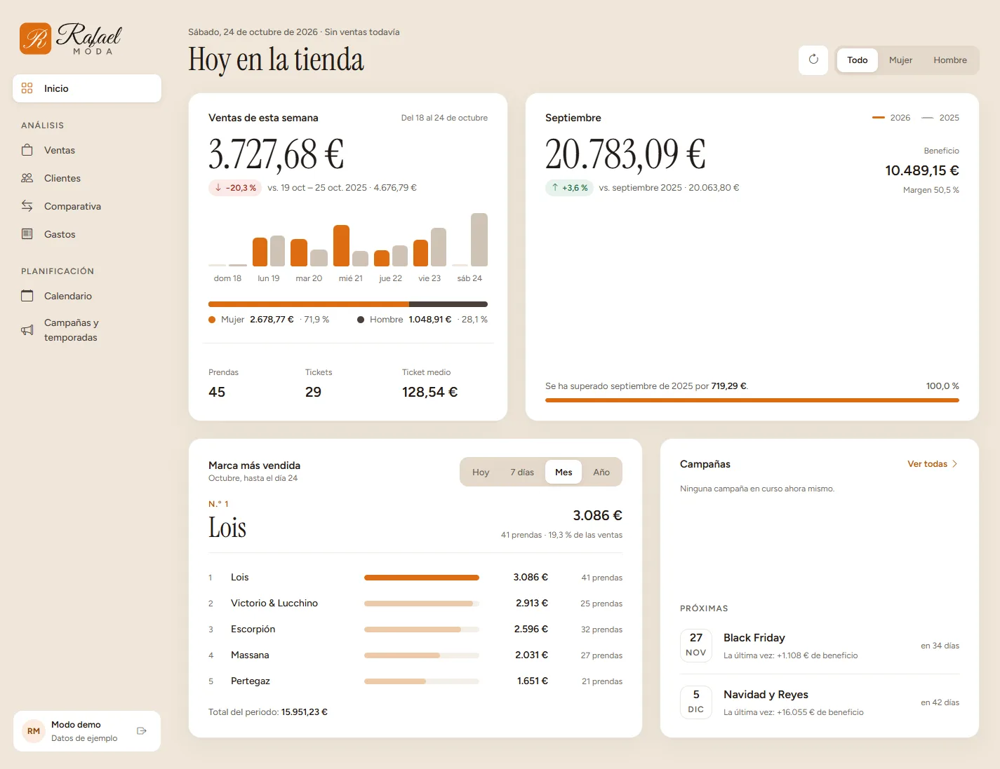
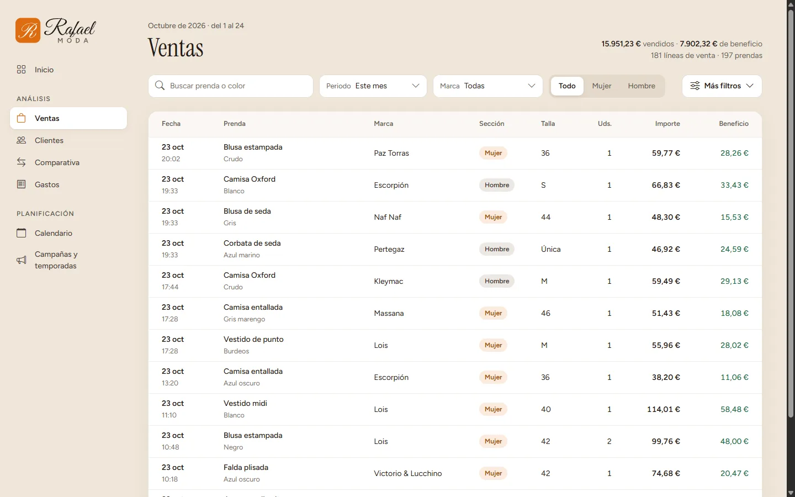
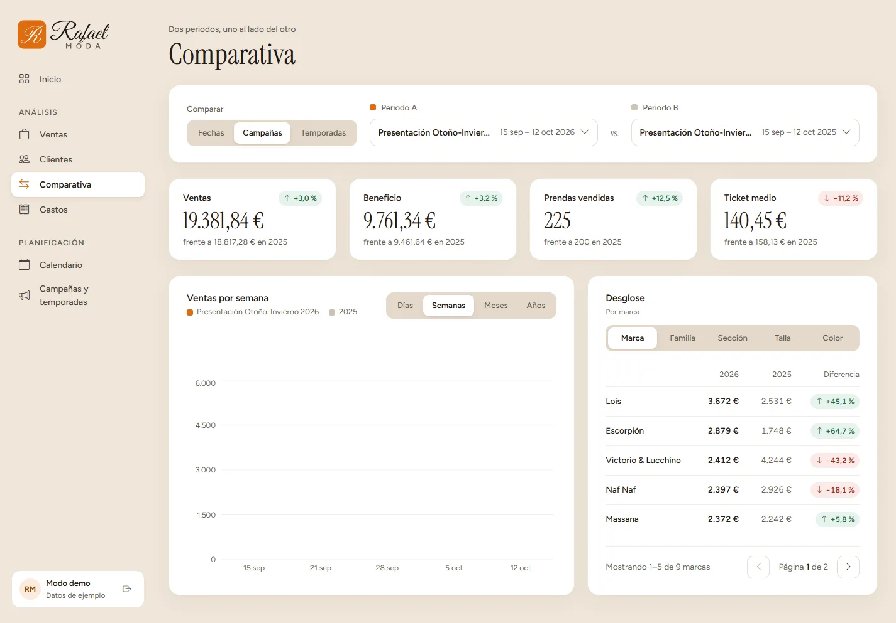
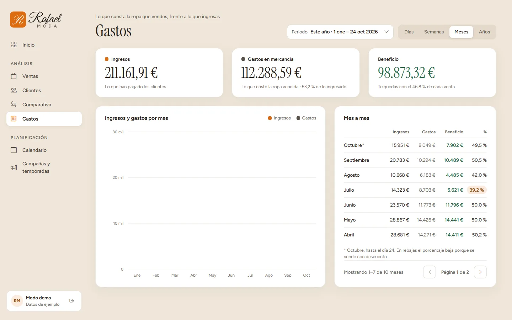
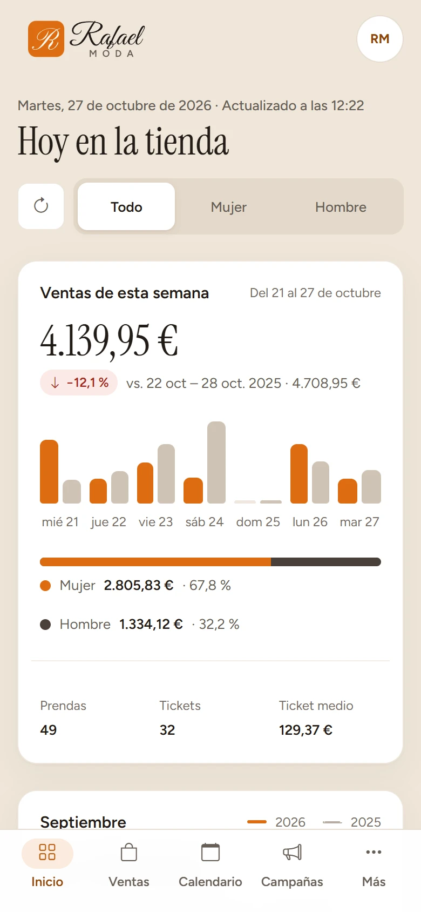
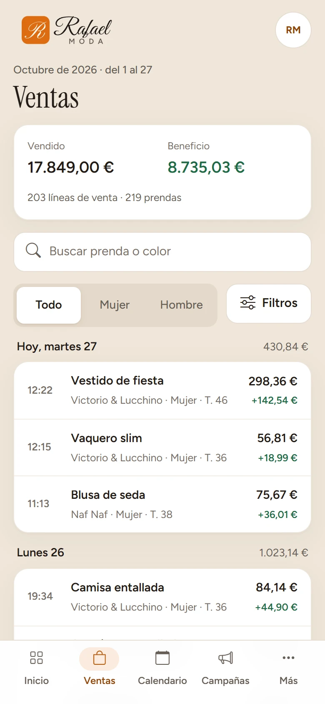

# Estadísticas — Rafael Moda

Panel de estadísticas para una tienda de ropa: ventas, gastos, clientes, comparativas entre periodos y planificación de campañas y temporadas. Empezó como proyecto final del ciclo de Desarrollo de Aplicaciones Web (DAW) y lo he rehecho entero para mi portfolio, con el negocio real de mi familia como punto de partida.

**Demo:** https://estadisticas-rafael-moda.vercel.app — pulsa «Entrar en modo demo». Todos los datos son inventados y la demo es de solo lectura.

## Capturas









<p>
  
  
</p>

## Qué hace

- **Inicio:** resumen de hoy, de la semana y del mes, con comparación con el año anterior, marca más vendida, campañas y gráfica del año acumulado.
- **Ventas:** tabla con búsqueda, periodo, marca, sección, familia, talla, color, precio y beneficio. Paginada en el servidor.
- **Clientes:** listado con filtros por provincia y ciudad.
- **Comparativa:** dos periodos (fechas, campañas o temporadas) lado a lado, por días, semanas, meses o años y desglosados por marca, familia, sección, talla o color.
- **Gastos:** ingresos, coste de la mercancía y beneficio por día, semana, mes o año.
- **Calendario:** campañas y cambios de temporada en una rejilla mensual.
- **Campañas y temporadas:** tipos y ediciones anuales, con generación automática de los años pendientes.
- Diseño propio, adaptado a móvil (menos de 992 px) y a escritorio.

## Tecnología

| Parte | Stack |
|---|---|
| Frontend | React 19, Vite, React Router, React Bootstrap y Bootstrap Icons, Recharts, Formik y Yup, Axios, date-fns |
| Backend | Node.js 24, Express 5, MySQL (`mysql2`), JWT, bcrypt |
| Pruebas y calidad | Vitest y Testing Library, ESLint |
| Despliegue | Vercel (frontend y API, Cron para la actualización diaria de la demo y Firewall para limitar los intentos de login) y Aiven (MySQL) |

Las estadísticas no se calculan en el navegador: el frontend pide a la API agregados ya sumados (`/api/statistics/...`) y las fechas de los periodos se calculan en el cliente (`frontend-react/src/utils/dates.js`, con tests). El SQL solo suma.

## Estructura

```
frontend-react/   interfaz (React + Vite)
backend-node/     API REST (Express) y scripts de la base de datos
docs/             notas de despliegue y de la actualización diaria de la demo
DESIGN.md         sistema de diseño (tokens, componentes, responsive)
```

El sistema de diseño está documentado en [DESIGN.md](DESIGN.md): los colores, tamaños, radios y sombras viven como variables `--rm-*` en `frontend-react/src/App.css`.

## Ejecutarlo en local

Necesitas Node.js 24 y un MySQL 8.0.16 o superior.

1. **Base de datos.** Crea una base de datos vacía y carga el esquema y los datos de ejemplo:
   ```
   mysql -u root -p rafael_moda < backend-node/db/schema.sql
   mysql -u root -p rafael_moda < backend-node/db/seed.sql
   ```
2. **Backend.**
   ```
   cd backend-node
   cp .env.example .env
   npm install
   npm run dev
   ```
   Rellena en `.env` la contraseña de MySQL (`DB_PASSWORD`) y un `JWT_SECRET` de al menos 32 caracteres. Con `DEMO_MODE=true` aparece el acceso de solo lectura. La API escucha en el puerto 8000.
3. **Frontend.**
   ```
   cd frontend-react
   cp .env.example .env.local
   npm install
   npm run dev
   ```
   Abre http://localhost:5173.

Los datos de ejemplo se regeneran hasta hoy con `npm run seed` (en `backend-node`).

## Pruebas

```
cd frontend-react && npm test
cd backend-node && npm test
```

Más ESLint en los dos proyectos con `npm run lint`.

## Seguridad

- Contraseñas con bcrypt y sesión con JWT (HS256, con caducidad).
- El modo demo solo permite GET, HEAD y OPTIONS.
- CORS limitado al dominio del frontend.
- Los secretos van en variables de entorno, nunca en el repositorio (consulta `.env.example`).
- Consulta [docs/despliegue.md](docs/despliegue.md) para el límite de intentos del login y la política de datos de la demo.

## Licencia

[MIT](LICENSE) © 2026 Manuel Padilla Pi.